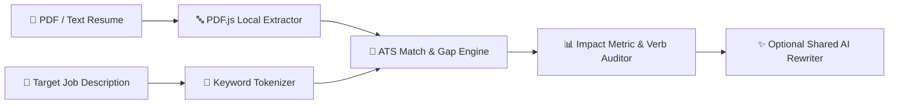

# 🎯 ATS-Lens AI

> **In-Browser Resume vs. Job Description ATS Matcher, Client-Side PDF Parser & Impact Bullet Optimizer.**

---

## ⚡ Features

- 📄 **Client-Side PDF Extraction**: Drop your `.pdf` resume directly in the browser via `PDF.js` — zero file uploads to external servers.
- 🔍 **Keyword Gap Radar**: Extracts high-signal technical & domain tokens from any Job Description and compares exact word-boundary coverage.
- 📊 **Impact Metric Auditor**: Flags weak phrasing (`Worked on`, `Helped`) and unquantified bullets missing measurable metrics (`%`, `ms`, scale).
- ✨ **Shared AI Engine Integration**: Automatically inherits your local Ollama or API configuration from [Krishna.OS](https://krishnagupta-coder.github.io/) for 1-click bullet rewrites.

---

## 🏗️ Pipeline

---

## 📜 License

MIT License — see [LICENSE](LICENSE).

